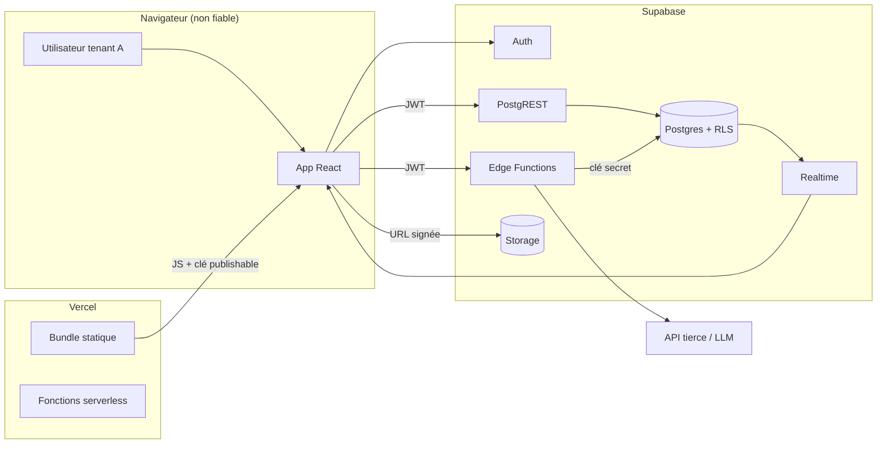
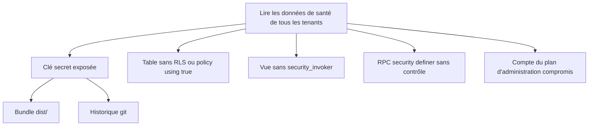

# Phase 2 : modélisation des menaces → `security/02-menaces.md`

Objectif : passer de « ce qui existe » (inventaire) à « ce qui peut mal tourner, pour qui, et à quel point ». C'est la détermination des dangers avant le plan de contrôle.

## Sommaire

1. DFD avec frontières de confiance
2. Modèle d'attaquant
3. STRIDE par flux
4. Cas d'abus et arbres d'attaque
5. Cotation
6. Format du registre TM-xxx

## 1. DFD (schéma des flux de données) en Mermaid

Dessiner les acteurs, processus, stockages et flux, et encadrer les **frontières de confiance** (là où le niveau de confiance change). Gabarit pour la stack de PA :



Numéroter les flux (F1, F2...) : STRIDE s'applique flux par flux. La frontière la plus critique est presque toujours **navigateur → Supabase**, car le client peut forger n'importe quelle requête. En multi-tenant, la seconde est **tenant A → tenant B**.

## 2. Modèle d'attaquant

Dresser la table attaquant x objectif x chemin x criticité **avant** les tests. Chez un petit éditeur, l'ordre réel n'est pas celui d'une banque : l'interne et le plan d'administration passent avant l'externe anonyme.

| # | Attaquant | Veut | Chemin typique |
|---|---|---|---|
| 1 | Autre entreprise cliente (multi-tenant) | Lire ou modifier les données d'un autre tenant | Requête authentifiée forgée qui franchit `tenant_id` depuis la console |
| 2 | Utilisateur légitime interne | Voir les dossiers de collègues ou d'autres services | IDOR (forcer un identifiant), filtre fourni par le client |
| 3 | Utilisateur ambitieux | Devenir admin | `UPDATE` de son propre rôle, RPC admin appelable, rôle choisi à l'inscription |
| 4 | Plan d'administration de l'éditeur | Tout, en contournant RLS | Compte Supabase, GitHub, Vercel, DNS, secrets de CI compromis : un seul suffit |
| 5 | Agents IA de l'éditeur | Accès involontaire aux données réelles | MCP ou agent avec accès SQL à la prod, injection de prompt via le dépôt |
| 6 | Externe anonyme | Exfiltrer | Clé secret dans le bundle ou l'historique git, table sans RLS, inscription ouverte |
| 7 | Ex-collaborateur, compte orphelin | Garder un accès | Session non révoquée, clé jamais tournée |
| 8 | Chaîne d'approvisionnement | Exécuter du code chez l'éditeur ou l'utilisateur | Paquet halluciné ou typosquat, action CI compromise |

Retenir les attaquants pertinents pour l'app. En multi-tenant, le n° 1 est la priorité.

## 3. STRIDE par flux

Pour chaque flux qui franchit une frontière, passer les six lettres. Le détail des sous-vecteurs, signaux et environnements est dans `stride-detaille.md`.

| Lettre | Propriété violée | Question à se poser sur le flux |
|---|---|---|
| S Spoofing | Authentification | Peut-on se faire passer pour un autre utilisateur ou un autre composant ? |
| T Tampering | Intégrité | Peut-on modifier une donnée ou un paramètre qu'on ne devrait pas ? |
| R Repudiation | Non-répudiation | Une action sensible laisse-t-elle une trace fiable ? |
| I Information disclosure | Confidentialité | Peut-on lire ce qui ne nous est pas destiné ? |
| D Denial of service | Disponibilité | Peut-on épuiser une ressource ou un quota ? |
| E Elevation of privilege | Autorisation | Peut-on obtenir des droits supérieurs ou franchir un tenant ? |

Pour les données personnelles, ajouter un passage **LINDDUN allégé** (vie privée) : la donnée est-elle reliable à une personne, détectable, divulguée à un tiers, conservée trop longtemps, utilisée sans information de la personne ?

Croiser systématiquement avec `partage/catalogue-risques.md` : chaque entrée V-xxx pertinente pour l'app doit apparaître dans au moins une menace.

## 4. Cas d'abus et arbres d'attaque

Un **cas d'abus** s'écrit comme une user story inversée, concrète et testable :

> En tant que membre du tenant A, je lis les déclarations d'accident du tenant B en appelant directement `/rest/v1/accidents` avec mon JWT.

Un **arbre d'attaque** décompose un objectif en chemins. Exemple, objectif « lire les données de santé de tous les tenants » :



Chaque feuille devient au moins un cas de test en phase 3.

## 5. Cotation (vraisemblance x impact)

Matrice simple 3 x 3, l'équivalent de la matrice gravité x probabilité en SST. Elle **oriente le plan**, elle ne remplace pas CVSS (qui viendra en phase 7 sur les findings).

| Vraisemblance \ Impact | Faible | Moyen | Élevé |
|---|---|---|---|
| Élevée | Moyen | Élevé | Critique |
| Moyenne | Faible | Moyen | Élevé |
| Faible | Faible | Faible | Moyen |

- **Vraisemblance élevée** : exploitable depuis le navigateur par un utilisateur ordinaire, ou pattern déjà vu dans le code (signal de la phase 1).
- **Impact élevé** : données sensibles nLPD, plusieurs tenants touchés, prise de contrôle.
- Toute menace inter-tenant sur données personnelles démarre au moins à **Élevé**.

## 6. Format du registre des menaces

```markdown
| ID | Flux | STRIDE | Attaquant | Menace (cas d'abus) | Catalogue | Vraisemblance | Impact | Cote |
|---|---|---|---|---|---|---|---|---|
| TM-001 | F3 navigateur → PostgREST | I | 1 Autre tenant | Un membre du tenant A lit les accidents du tenant B via /rest/v1/accidents | V-DB-02, V-DB-05 | Élevée | Élevé | Critique |
```

- Un identifiant TM-xxx par menace, jamais réutilisé.
- Statut implicite : toutes les menaces sont **théoriques** tant qu'un test ne les a pas confirmées.
- Trier le registre par cote décroissante.
